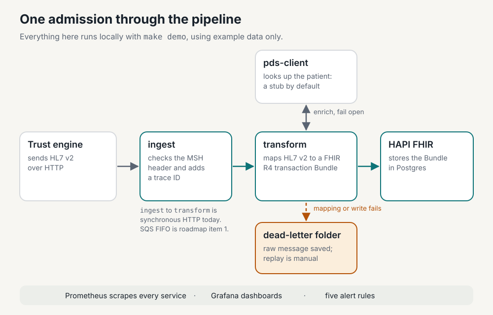
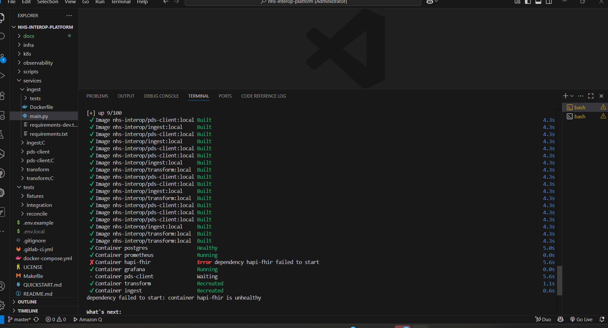
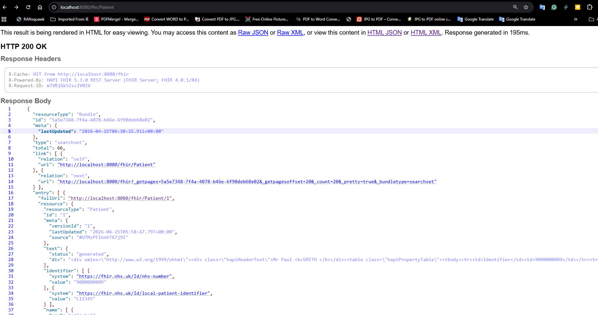
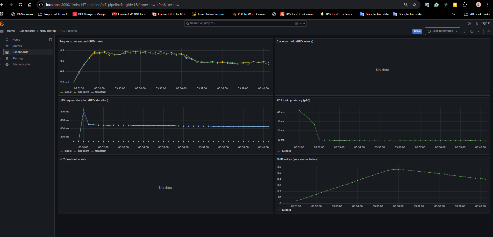
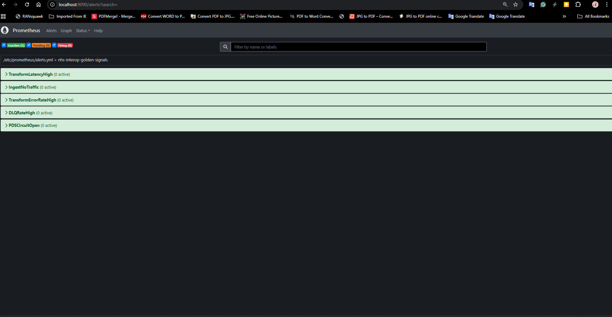
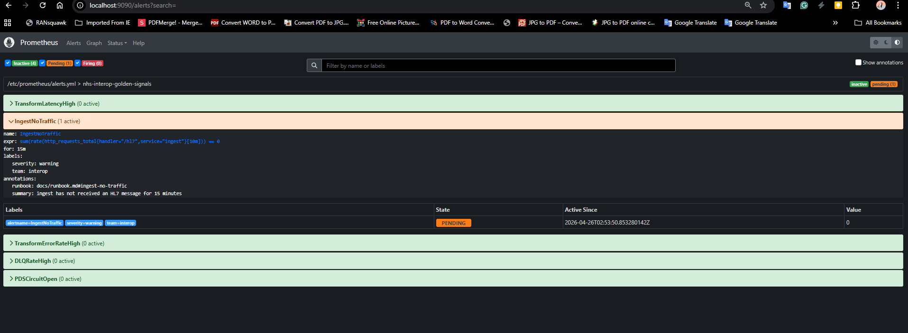

# NHS Interop Platform


> An HL7 v2 to FHIR R4 interoperability service with an NHS PDS lookup, that runs on a laptop.
> A small, working version of the layer NHS trusts need between hospital systems and national services, built in public over a seven-part series. Production-shaped, not production-ready: see the known limitations in [CHANGELOG.md](CHANGELOG.md).



## Start here

Pick the line that sounds like you.

- New to health tech and want to try it: follow the quick start below, then [QUICKSTART.md](QUICKSTART.md), which has you break the system on purpose and watch the alert arrive. You need Docker and `make`. No NHS account, no cloud account, synthetic test data only.
- Switching careers into tech or health tech: read [the seven articles](blog/README.md) in order. Each one is a real defect, how it was found and how it was fixed, which is what interviews ask about.
- Experienced engineer: [docs/architecture.md](docs/architecture.md), then [docs/ai-usage.md](docs/ai-usage.md) for how this was built and where each defect came from.
- Funding or buying health tech: the known limitations in [CHANGELOG.md](CHANGELOG.md) and "Claimed, not built" in [docs/security.md](docs/security.md). They say plainly what this does not do, which is the question worth asking of any system.

## Why this exists

NHS trusts running vendor EPRs emit HL7 v2 natively, but national NHS services are moving to FHIR. Every trust therefore needs an interoperability layer that translates HL7 v2 into FHIR, enriches it with national data (PDS), and exposes a FHIR REST API. This repository is a small implementation of that layer: runnable locally with `make demo`, checked by GitHub Actions on every pull request, observed with Prometheus and Grafana, and with Terraform for AWS EKS that has been validated but never applied.

## Blog series

A seven-part series about this project on dev.to, published weekly from October to November 2026. The index and the drafts are in [blog/](blog/README.md).

## Quick start

Requires Docker 24+ and `make`.

```bash
git clone https://github.com/ND-codes/nhs-interop-platform.git
cd nhs-interop-platform
cp .env.example .env.local
make demo          # builds and starts all nine services
make walkthrough   # sends sample messages and checks every step works
```

Then open:

- FHIR REST API: <http://localhost:8080/fhir/Patient>
- Grafana: <http://localhost:3000> (admin / admin)
- Prometheus: <http://localhost:9090>
- Mail inbox, where alerts arrive: <http://localhost:8025>
- Ingest service: <http://localhost:8000/docs>

`make walkthrough` runs eight checks and stops at the first one that fails. The same checks run in CI on every pull request.

See `docs/` for the full architecture, runbook, security model and HL7→FHIR mapping. For the longer walkthrough, including breaking it on purpose, see [QUICKSTART.md](QUICKSTART.md).


## Screenshots



*Live Grafana HL7 Pipeline dashboard during a 30-message burst.*



*HAPI FHIR Patient browser after ingesting an ADT^A01 with NHS number 9000000009.*

### Grafana: HL7 Pipeline dashboard from Day 2



*Grafana dashboard after 10 minutes background load.*

### Prometheus: all targets UP


*Prometheus shows no alerts on TransformLatencyHigh, IngestNoTraffic, TransformErrorRateHigh, DLQRateHigh, PDSCircuitOpen.*

### Prometheus: IngestNoTraffic alert


*IngestNoTraffic alert after background load was stopped for 15 minutes.*


## Repository layout

```
.
├── services/
│   ├── ingest/       # FastAPI HL7 v2 receiver
│   ├── transform/    # HL7 v2 → FHIR R4 mapper
│   └── pds-client/   # NHS PDS FHIR Sandbox client
├── infra/terraform/  # AWS VPC, EKS, RDS, S3, KMS, IAM
├── k8s/
│   ├── helm/         # per-service Helm charts
│   └── argocd/       # app-of-apps GitOps definitions
├── observability/    # Prometheus, Grafana, Alertmanager
├── tests/            # unit, integration, reconciliation
├── docs/             # architecture, HL7/FHIR mapping, security, runbook
├── blog/             # blog series index and drafts
├── scripts/          # helper scripts (send-adt.sh, walkthrough.sh, break-pds.sh)
├── .github/workflows/ # CI: lint, tests, scans, alert rules, the walkthrough
├── docker-compose.yml
├── Makefile
└── CHANGELOG.md
```

## Roadmap

Planned work is tracked as [issues labelled roadmap](https://github.com/ND-codes/nhs-interop-platform/labels/roadmap). The seven items from [Lessons learnt](docs/lessons-learnt.md) are:

1. Put an SQS FIFO queue between ingest and transform.
2. Add OpenTelemetry distributed tracing.
3. Wire up External Secrets Operator.
4. Extract the Terraform into reusable modules.
5. Add contract tests against the PDS sandbox.
6. Add chaos tests for the dead-letter path and replay.
7. Document Azure parity.

## Documentation

- [Quickstart, the longer walkthrough](QUICKSTART.md)
- [Architecture](docs/architecture.md)
- [HL7 v2 to FHIR R4 mapping](docs/hl7-fhir-mapping.md)
- [Runbook](docs/runbook.md)
- [Security model](docs/security.md)
- [Lessons learnt](docs/lessons-learnt.md)

## Disclaimer

This is a personal project. It is not affiliated with or endorsed by NHS England or any NHS organisation. It uses the public PDS FHIR sandbox and synthetic test data only, and it contains no real patient data. Views are my own.

## Licence

MIT. See [LICENSE](LICENSE).
