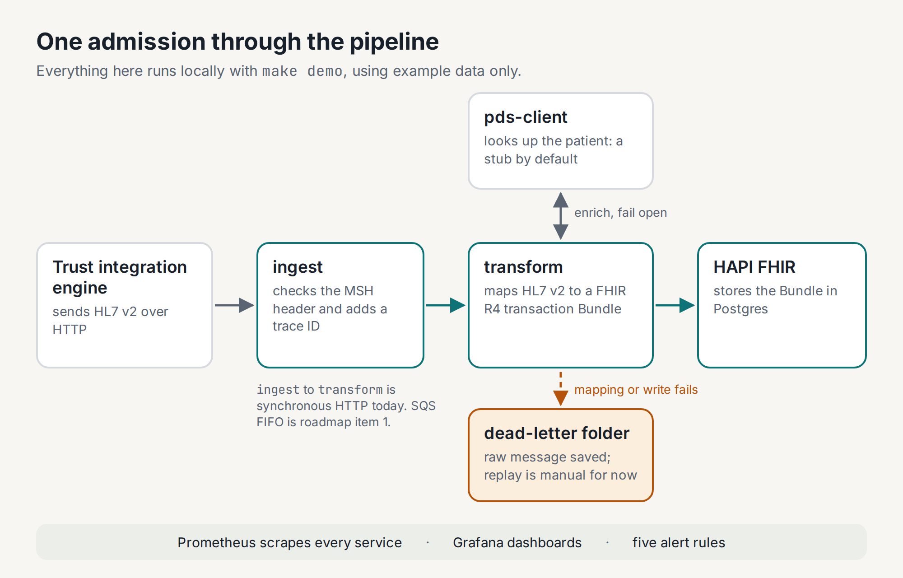
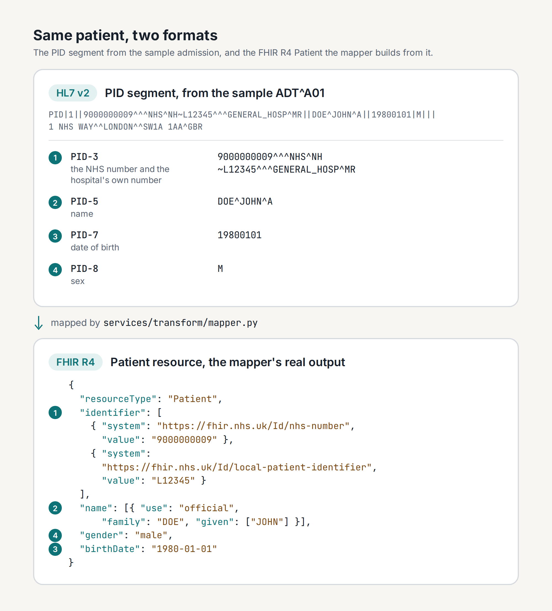

I run an electronic patient record (EPR) platform in UK healthcare.

This series walks through a project I built around one question: how does a patient's data get from a hospital system that speaks HL7 v2 to services that expect FHIR? Part 1 covers the problem and the architecture. The next six parts go deeper, one area at a time.

## The problem

Two standards meet here.

HL7 version 2 is the older one. HL7 International calls it "the workhorse of electronic data exchange in the clinical domain". A v2 message is plain text. Each segment is a line of fields separated by pipes, and the standard says "the segment terminator is always a carriage return". An admission is sent as an ADT^A01 message, which the standard describes as "sent as a result of a patient undergoing the admission process". Its segments include MSH for the message header, PID for patient identification and PV1 for the patient visit.

FHIR is the newer one. It models data as resources, such as Patient and Encounter, and exchanges them as JSON or XML over a REST API.

National NHS services are moving to FHIR. The NHS service manual says the PDS FHIR API "meets the latest standards". It also says that if you want to start using a PDS API, "this is the version to use". The older HL7 V3 version is under review.

So a hospital system that sends HL7 v2 needs something in between. That layer has to translate each message, check the patient against national records, and store the result somewhere that speaks FHIR. This project builds that layer.

## What I built

The NHS Interop Platform is a small, production-shaped reference implementation. It isn't running in a hospital. It runs on a laptop with one command, `make demo`, using example data only.



Five parts do the work:

1. `ingest` is a FastAPI service that receives HL7 v2 over HTTP. It checks the MSH header, gives the message a trace ID and passes it on.
2. `transform` parses the message and maps it to a FHIR R4 transaction Bundle.
3. `pds-client` looks the patient up in the Personal Demographics Service (PDS), the national database of NHS patient details. In the local demo it runs in stub mode by default and returns a canned record, so nothing leaves the laptop. It can call NHS England's PDS FHIR sandbox instead.
4. A HAPI FHIR server stores the result in Postgres.
5. Prometheus scrapes the services and Grafana shows the pipeline. Five alert rules cover traffic, latency, errors, dead letters and the PDS circuit breaker.

The repo also holds Terraform for AWS (VPC, EKS, RDS, S3, KMS and IAM), Helm charts and Argo CD definitions. They describe where the platform would run, and I've checked them with `terraform plan`. Everything in this article runs locally. Part 2 covers the AWS side.

## Following one admission through

This is the sample admission from the repo's test fixtures:

```text
MSH|^~\&|CERNER|GENERAL_HOSP|INTEROP|GENERAL_HOSP|20260101120000||ADT^A01|MSG00001|P|2.5
EVN|A01|20260101120000
PID|1||9000000009^^^NHS^NH~L12345^^^GENERAL_HOSP^MR||DOE^JOHN^A||19800101|M|||1 NHS WAY^^LONDON^^SW1A 1AA^GBR
PV1|1|I|WARD1^BED1^ROOM1||||12345^SMITH^JANE|||GEN
```

PID carries the patient. PID-3 holds two identifiers, separated by `~`: the NHS number, with `NHS` as its assigning authority, and the hospital's own number. PID-5 is the name, PID-7 the date of birth and PID-8 the sex.

This is the FHIR Patient the mapper builds from that segment. I ran the mapper on the fixture to get it, so it's the real output:

```json
{
  "resourceType": "Patient",
  "identifier": [
    { "system": "https://fhir.nhs.uk/Id/nhs-number", "value": "9000000009" },
    { "system": "https://fhir.nhs.uk/Id/local-patient-identifier", "value": "L12345" }
  ],
  "name": [{ "use": "official", "family": "DOE", "given": ["JOHN"] }],
  "gender": "male",
  "birthDate": "1980-01-01"
}
```



The middle initial, `A`, isn't mapped. PID-5 has a component for it and FHIR takes more than one entry in `given`, so that is a real gap rather than a limitation of either format. Part 3 is about the mapping, and it's on the list there.

PV1 becomes an Encounter, and the `I` in PV1-2 becomes the FHIR class code `IMP`, an inpatient encounter.

Three things happen next:

1. Enrichment. `transform` asks `pds-client` for the patient by NHS number. The PDS values for name, gender, date of birth, address and telephone replace the ones from the message, and the hospital's own identifier is kept. In the local demo the stub's canned record wins, which is why the stored patient is called Paul Smith rather than John Doe.
2. The write. `transform` sends the Patient, the Encounter and a MessageHeader to HAPI FHIR as one transaction Bundle.
3. The failure path. If mapping or the write fails, the raw message is saved to a dead-letter folder and a counter feeds the DLQRateHigh alert. Replaying it is still a manual step.

## Three design decisions

Fail open on enrichment. If PDS is slow or down, the pipeline carries on with the demographics from the message. A circuit breaker stops calling PDS after five failures in a row, and lets one call through again after 30 seconds. A slow lookup shouldn't stop an admission being recorded.

Fail closed on writes. A failed FHIR write is never quietly dropped. The raw message is saved to the dead-letter folder so it can be replayed. More on this one below, because writing this article is how I found out it wasn't true.

One transaction per message. The FHIR specification says that in a transaction, "all interactions or operations either succeed or fail together". An admission is saved whole or not at all, never as a Patient without its Encounter.

## The bug I found writing this article

I wanted a screenshot of a dead-lettered message for the section above, so I pointed `transform` at a FHIR server that wasn't there and sent the fixture in. Nothing arrived in the dead-letter folder, and the service answered 500 rather than 502.

The write path looked fine:

```python
@retry(stop=stop_after_attempt(3), wait=wait_exponential(multiplier=0.2, max=2))
async def _persist_bundle(http, bundle, trace_id):
    resp = await http.post(FHIR_BASE_URL, json=bundle, ...)
    resp.raise_for_status()
    return resp.json()
```

and the caller catches the error the way you would expect:

```python
try:
    result = await _persist_bundle(...)
except httpx.HTTPError as exc:
    _dlq(raw, trace_id, reason="fhir_write_error")
    raise HTTPException(status_code=502, ...)
```

The retry decorator is the problem. Tenacity's documentation says that when a function fails its final time, "a RetryError is raised", and that the original exception shows up "somewhere in the middle of the stack trace". `RetryError` is not an `httpx.HTTPError`, so the `except` never matched. Every retried write failure escaped the handler, skipped the dead-letter call and came back as an unhandled 500.

The fix is one argument. Tenacity's `reraise=True` raises the underlying exception instead:

```python
@retry(stop=stop_after_attempt(3), wait=wait_exponential(multiplier=0.2, max=2), reraise=True)
```

The test is the more useful half. It mocks HAPI FHIR with `respx`, so it needs no running stack, and it asserts the three things the rule actually promises: the retries ran, the raw message is on disk, and the counter went up.

```python
with respx.mock(assert_all_called=True) as hapi:
    route = hapi.post(FHIR_URL).mock(return_value=httpx.Response(503))
    with TestClient(main.app) as client:
        response = client.post("/transform", content=ADT_A01,
                               headers={"X-Trace-Id": "write-fails"})

assert route.call_count == 3
assert response.status_code == 502
assert _dlq_count() == before + 1

written = (tmp_path / "write-fails.hl7").read_bytes()
assert written == ADT_A01.encode("utf-8")
assert b"\n" not in written
```

That last pair of lines is a second lesson. My first version of the test read the file back with `read_text()` and failed on a message that was written correctly, because Python's universal newline handling turns the HL7 carriage returns into line feeds on the way in. Reading the bytes is the only way to see what is really on disk.

Both changes are in the code this article is tagged against.

I'd had the "fail closed on writes" rule written down in `docs/architecture.md` since the first week of the project. It read like a property of the system. It was a property of the documentation.

## Worth stealing

- Normalise line endings before parsing. HL7 v2 ends segments with a carriage return, but files and editors add line feeds. The parser turns both into carriage returns first, and the repo's `.gitattributes` stops Git converting the HL7 test fixtures.
- Give every message a trace ID at the front door. `ingest` creates one and passes it on in an `X-Trace-Id` header, so one admission can be followed through every service's logs.
- Test the failure path, not just the happy one. A retry wrapper, a circuit breaker and a dead-letter folder all look right in a diagram. The test is what tells you whether they are wired together.
- Make the demo one command. `make demo` builds and starts the whole stack and waits until the FHIR server answers, so anyone can check the work quickly.

## Where AI helps here, and where it doesn't

I built this project with Claude Code, Anthropic's coding assistant. It drafted the scaffolding for all three services, the Helm charts, the Prometheus rules and the Grafana dashboard, and the first pass of most of the docs. I made the mapping and architecture decisions, and I reviewed everything that went in.

It was quickest where the shape was clear. The Helm charts show that best: three services, seven templates each, and the only real differences between them are the name, the port, the environment variables and the resource requests. Once the first chart is right, writing the third one by hand is just typing.

It didn't replace checking, and the failure above is the clearest case. The retry decorator, the `except` clause and the dead-letter helper are each individually what you would write. Nothing in the code looks wrong until something runs it. Two other passes over the repo turned up the same kind of thing: two AWS statements in the docs that no longer matched the Terraform, a description of an in-memory queue that the code doesn't have, and an alert rule, PDSCircuitOpen, that watches a metric called `pybreaker_state` which none of the services export. That last one can't fire at all. Part 4 is about observability, and fixing it belongs there.

The rule I'm keeping: AI drafts, and the specification, the tests and the running system decide.

## What I'd do differently

I'd use SQS from the start, not a synchronous HTTP hand-off. Right now, if `transform` is down, `ingest` logs the error and still replies 200, marked `forwarded: false`, and nothing retries the message. That is the same failure as the one above, one service earlier, and the dead-letter folder doesn't help because the message never reached the service that owns it. A queue makes the hand-off durable instead of hopeful. It's the first item on the roadmap, and Part 6 shows the fix.

## Sources

- [HL7 International: HL7 Version 2 product brief](https://www.hl7.org/implement/standards/product_brief.cfm?product_id=185)
- [HL7 v2.5.1, Chapter 2: Control (hosted by HL7 Europe)](https://www.hl7.eu/HL7v2x/v251/std251/ch02.html)
- [HL7 v2.5.1, Chapter 3: Patient Administration (hosted by HL7 Europe)](https://www.hl7.eu/HL7v2x/v251/std251/ch03.html)
- [HL7 FHIR R4: RESTful API, batch and transaction](https://hl7.org/fhir/R4/http.html)
- [NHS service manual: Personal Demographics Service](https://service-manual.nhs.uk/standards-and-technology/technology/personal-demographics-service-PDS)
- [NHS England: Personal Demographics Service FHIR API](https://digital.nhs.uk/developer/api-catalogue/personal-demographics-service-fhir)
- [Tenacity documentation](https://tenacity.readthedocs.io/en/latest/)
- [pybreaker on PyPI](https://pypi.org/project/pybreaker/)
- [The code for this article, tag part-1](https://github.com/ND-codes/nhs-interop-platform/tree/part-1)

## Next

Part 2, on 21 October, goes from `docker compose up` to Terraform on AWS.

What does the integration engine in your organisation still speak: HL7 v2, FHIR, or both?

---

This is a personal project. It is not affiliated with or endorsed by NHS England or any NHS organisation. It uses the public PDS FHIR sandbox and synthetic test data only. Views are my own.
