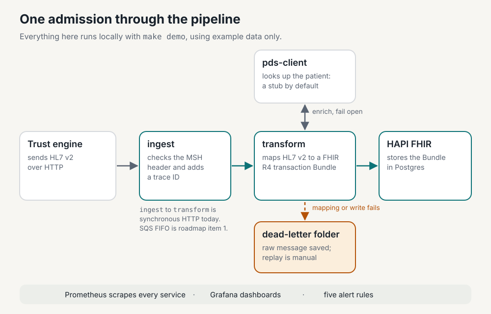

# Architecture

## One-paragraph description

HL7 v2 messages from the trust integration engine land at an AWS ALB fronting the EKS cluster. The `ingest` service validates the MSH header and forwards the payload to `transform`, which parses the message, maps it to a FHIR R4 transaction Bundle, optionally enriches the Patient via `pds-client` (a thin wrapper around the NHS Spine PDS FHIR Sandbox), and persists the bundle to a HAPI FHIR server backed by RDS Postgres. Failed messages are dead-lettered to a local path. Prometheus scrapes every service, Grafana renders the dashboards, and Alertmanager delivers notifications. GitHub Actions gates quality (lint, test, Trivy, Semgrep, Gitleaks, Syft SBOM, Prometheus rule tests); ArgoCD reconciles cluster state from Git.

That paragraph describes the intended shape. Four of its claims were wrong until November 2026, and the corrections are worth stating rather than quietly editing, because each one was believed for weeks:

- Dead-lettering went to S3. It did not and does not. `infra/terraform/s3.tf` creates a bucket with the right encryption and retention, and no service imports an S3 client. The dead-letter path is a Docker volume locally and an `emptyDir` in Kubernetes. See Part 5.
- Alertmanager routed pages. Nothing ran an Alertmanager, `prometheus.yml` had no `alerting` block, and the Alertmanager configuration pointed at a mail service that no file in the repository started. Rules evaluated, showed as Firing in the Prometheus UI, and notified no one. Fixed locally in Part 6; there is still no Alertmanager in the Helm charts and no paging integration anywhere.
- GitLab CI gated quality. The repository moved to GitHub Actions in Week 2 and `.gitlab-ci.yml` was deleted in Part 5.
- CI pushed to an image registry. Images are built and scanned, and not pushed, because there is nowhere deployed to push them to.

## Core design principles

- **Fail open on enrichment, fail closed on writes.** PDS outages degrade data quality but never drop messages. FHIR write failures dead-letter for replay.
- **Stateless services, stateful store.** Every service is a Deployment that can be replaced at will; state lives in RDS, S3 and Secrets Manager.
- **Least privilege by default.** IRSA, not node IAM. NetworkPolicy deny-all with explicit allow-list. CMK-encrypted everything.
- **Observability is not optional.** Every message carries a trace id through all three services, every service emits RED dashboards, and every alert maps to a runbook section. Note that the trace id is log correlation, not distributed tracing: there is no OpenTelemetry in these services, and spans across the pipeline would be the next step rather than something already here.

## Non-functional targets

These are design targets. None of them has been measured, because nothing has
been deployed to AWS, and the MTTR figure in particular has no baseline to
have been reduced from. They describe what the shape is meant to achieve.

| Signal        | Target                                           | How we hit it                                                |
|---------------|--------------------------------------------------|--------------------------------------------------------------|
| Availability  | 99.95%                                           | Multi-AZ everything, minAvailable: 2 PDB, CrossZone ALB.     |
| RPO           | ≤5 minutes                                       | RDS PITR, S3 versioning, ArgoCD Git-backed state.            |
| RTO           | ≤15 minutes                                      | Automated failover at every tier.                            |
| MTTR          | 30% reduction vs baseline                        | Alerts wired direct to runbook sections with mitigation steps. |
| Throughput    | 200 msg/sec sustained, 1,000 msg/sec burst       | HPA on CPU + custom `hl7_queue_depth` metric (roadmap).      |

## Why this shape (and not something else)

- **Why not one monolith?** Ingest, transform and PDS have different failure modes and different scaling profiles. Splitting them lets us bulkhead around PDS without capping our ingress throughput.
- **Why HAPI FHIR, not HealthLake?** HAPI FHIR is open-source, production-proven at NHS trusts, and avoids regional availability caveats. HealthLake is compelling for analytics overlay but was not a hard requirement for this scope.
- **Why synchronous HTTP between ingest and transform, not SQS from day one?** Keeps the local demo one-command. SQS FIFO is on the roadmap and is a drop-in swap at the ingest→transform boundary.
- **Why EKS, not ECS Fargate?** The JD emphasises Kubernetes, and the team's existing tooling (ArgoCD, Helm, Prometheus) assumes Kubernetes.
