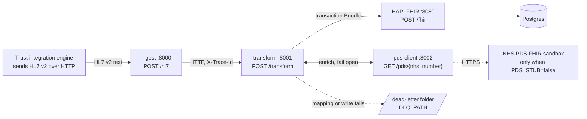
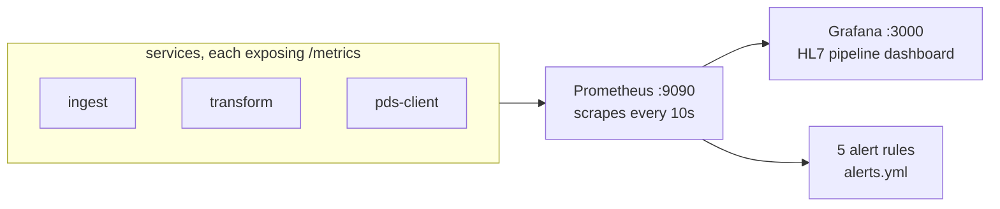
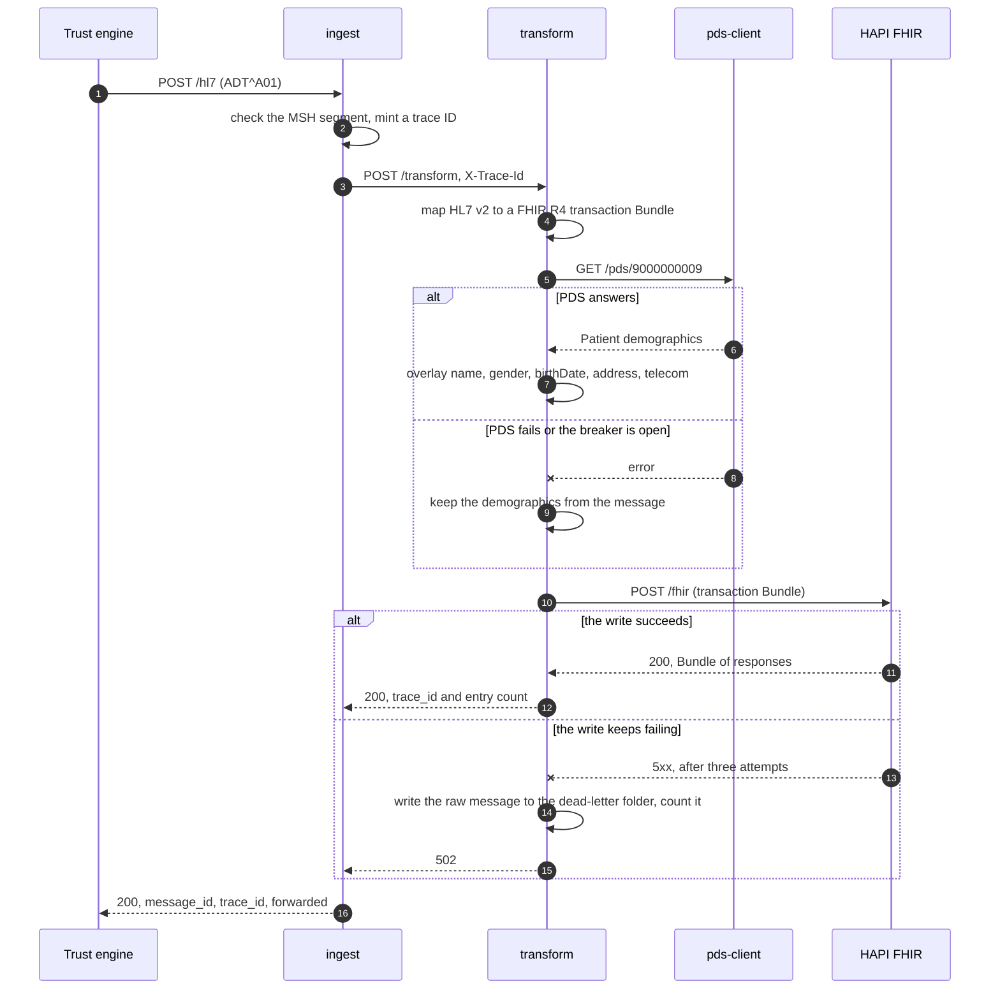
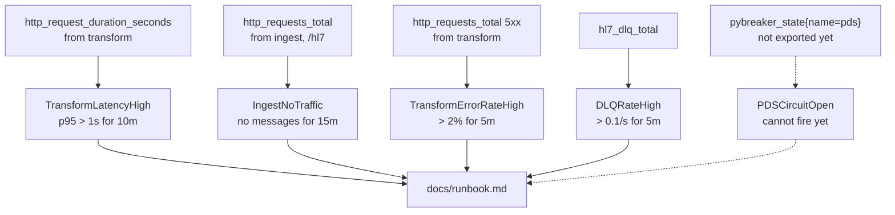

# Diagrams

The diagrams below are Mermaid, so GitHub renders them from this file and they stay
reviewable in a pull request. `docs/architecture.svg` is the exported picture used in
the README and in the blog series.

Everything here describes the local Docker Compose stack, which is what `make demo`
starts. The AWS topology is in [architecture.md](architecture.md).

## Services and message flow

`ingest` calls `transform` over synchronous HTTP. There is no queue yet: an SQS FIFO
queue between them is the first item on the roadmap.

## Monitoring

## One admission, end to end

The PDS branch is the fail-open rule: a lookup that fails degrades the data rather
than stopping the admission being recorded. The write branch is the fail-closed rule:
a Bundle that cannot be stored is kept for replay instead of being dropped.

`ingest` answers 200 with `forwarded: false` when `transform` cannot be reached, and
nothing retries the message. That is the gap the queue closes.

## Alerting

The rules are in [observability/prometheus/alerts.yml](../observability/prometheus/alerts.yml).
`PDSCircuitOpen` is drawn with a dashed line because no service exports
`pybreaker_state` yet, so the rule cannot fire. Exporting the breaker state is
tracked on the roadmap.
